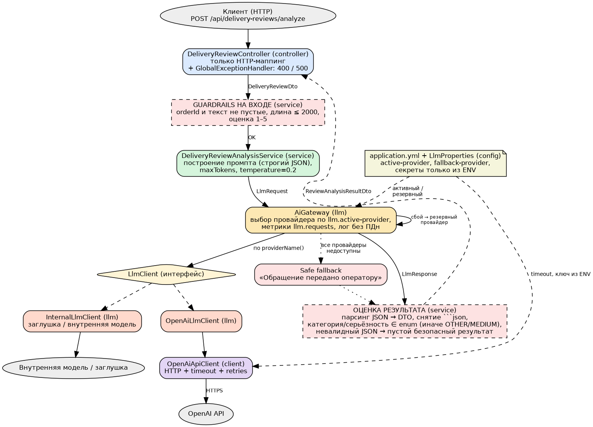

# Анализ отзывов о доставке — Spring Boot + AI Gateway

Лабораторная работа №1 (вариант 5, логистическая компания): сервис принимает отзыв клиента о доставке и с помощью LLM
выделяет проблемные точки (задержка, повреждение, поведение курьера, неверный адрес, утеря). Бизнес-логика изолирована
от конкретного LLM-провайдера через абстракцию `LlmClient` и единую точку входа `AiGateway`.

## Веб-интерфейс и бесплатная нейросеть

```bash
./mvnw spring-boot:run           # Windows: mvnw.cmd spring-boot:run (Maven ставить не нужно)
```

Открыть http://localhost:8080/, ввести номер заказа, текст отзыва и оценку, нажать «Проанализировать».
По умолчанию активен провайдер `free` — бесплатная OpenAI-совместимая нейросеть [Pollinations](https://pollinations.ai)
без ключа (ответ 10–20 с, лимит ≈ 1 запрос в 45 с с одного IP). При сбое или превышении лимита `AiGateway`
переключается на резервного провайдера `internal` (заглушка, ответ начинается с `[internal-stub]`).
Провайдер выбирается переменной окружения `LLM_ACTIVE_PROVIDER` (`free` | `openai` | `internal`).

## Быстрый старт

Требования: JDK 17+ (Maven ставить не обязательно — есть `mvnw`). Ключ OpenAI для запуска не нужен.

```bash
mvn clean verify                 # сборка и все тесты
mvn spring-boot:run              # запуск на http://localhost:8080 (провайдер internal - заглушка)

curl -X POST http://localhost:8080/api/delivery-reviews/analyze \
  -H "Content-Type: application/json" \
  -d '{"orderId":"ORD-123","reviewText":"Курьер приехал на 3 дня позже, коробка помята","rating":2}'
```

Ответ при провайдере `internal` (заглушка возвращает валидный JSON, но реального анализа не делает):

```json
{"orderId":"ORD-123","summary":"[internal-stub] Заглушка внутренней модели: ...","problems":[]}
```

Пустой текст отзыва, отсутствие `orderId`, текст длиннее 2000 символов или оценка вне диапазона 1–5 дают HTTP 400 с телом
`{"error":"BAD_REQUEST","message":"..."}`.

### Переключение на реальный OpenAI

```bash
export OPENAI_API_KEY=<ваш ключ>      # секрет только в окружении, в репозитории его нет
export LLM_FALLBACK_PROVIDER=internal # необязательно: резервный провайдер при сбое
# затем в application.yml: llm.active-provider: openai  (или --llm.active-provider=openai)
mvn spring-boot:run
```

Метрики: `GET /actuator/metrics/llm.requests` (появляются после первого обращения к LLM), `GET /actuator/prometheus`.

## Что реализовано (по этапам лабораторной)

| Этап | Что сделано | Где смотреть |
|---|---|---|
| 1. AI Gateway | Интерфейс `LlmClient`; реализации `OpenAiLlmClient` и `InternalLlmClient`; `AiGateway` выбирает провайдера по `llm.active-provider`; переключение на резервного (`llm.fallback-provider`); timeouts, retries, безопасный fallback; метрики `llm.requests`; логи без текста отзыва | `llm/`, `client/`, `config/`, `application.yml` |
| 2. AI-ready структура | Слои `controller → service → llm → client`, правила для AI-ассистента, unit-тесты service-layer | `README-AI.md`, `src/test/` |
| 3. Сравнение контекстов | Два режима промпта, ответы и сравнительный анализ | `docs/stage3-*` |
| 4. Разбор AI-прототипа | Прототип «в одном контроллере», 8 проблем, доработка, риски, архитектурное правило | `docs/stage4-*` |
| 5. Отчёт | Полный отчёт с диаграммой, листингами и ответами на 15 вопросов | `docs/Отчет_Лабораторная_1_Вариант5.docx` |

Дополнительно: интеграционные тесты `@SpringBootTest` (в том числе сценарий сбоя провайдера), тесты HTTP-клиента на
`MockRestServiceServer`, ADR по ключевым решениям (`docs/adr/`), единый обработчик ошибок REST (`GlobalExceptionHandler`).

## Архитектура



```
com.logistics.delivery
├── controller   — REST-контроллер и GlobalExceptionHandler (только HTTP)
├── service      — валидация, промпт, разбор и нормализация ответа модели
├── llm          — LlmClient, OpenAiLlmClient, InternalLlmClient, AiGateway, LlmRequest/LlmResponse
├── client       — OpenAiApiClient: единственное место реального HTTP-вызова
├── dto          — контракты API (record)
├── domain       — категории проблем и уровни серьёзности (enum)
└── config       — LlmProperties, RestTemplate с таймаутами
```

Ключевые решения:

- **Изоляция от провайдера.** `service` зависит только от `AiGateway`; смена провайдера — правка `application.yml`.
- **Секреты.** В репозитории только `${OPENAI_API_KEY:}`; без ключа HTTP-вызов не выполняется.
- **Отказоустойчивость.** Timeouts и retries в `OpenAiApiClient` → переключение на резервного провайдера в `AiGateway` →
  безопасный ответ пользователю (HTTP 200, «обращение передано оператору») вместо ошибки 500.
- **Ответ модели — недоверенные данные.** Снятие markdown-обёртки, парсинг JSON, нормализация категорий (значение вне
  списка → `OTHER`), безопасный результат при невалидном JSON.
- **Логи и метрики.** Логируются только провайдер, номер попытки и тип ошибки; текст отзыва и ответ модели не логируются.

## Тесты

```bash
mvn clean verify
```

| Класс | Что проверяет |
|---|---|
| `DeliveryReviewAnalysisServiceTest` | Валидация, разбор JSON, невалидный JSON, fallback, нормализация категорий (`AiGateway` замокан) |
| `AiGatewayTest` | Выбор провайдера, смена по конфигурации, fallback, резервный провайдер, неизвестный провайдер, метрики |
| `OpenAiApiClientTest` | Формат запроса Chat Completions, retries, ошибка после всех попыток, отсутствие ключа (`MockRestServiceServer`) |
| `DeliveryReviewApiIntegrationTest` | Вся цепочка через HTTP на заглушке; ответ 400 на некорректный ввод |
| `DeliveryReviewFallbackIntegrationTest` | Сбой внешнего провайдера → HTTP 200 с fallback, а не 500 |

## Ограничения и допущения

- Вызов OpenAI реализован по формату Chat Completions и проверен на эмулированном сервере; с реальным ключом и живым API
  в рамках работы не запускался.
- Резервирование — это failover без состояния, а не полноценный circuit breaker (см. `docs/adr/0003-failover-and-fallback.md`).
- Провайдер `internal` — заглушка: структура ответа валидна, но анализа текста нет.
- Один `RestTemplate` для всех внешних провайдеров; read-timeout берётся из `llm.providers.openai.timeout`.
- Защита от prompt injection в тексте отзыва ограничена ограничением длины и контролем формата ответа.

## Структура репозитория

```
├── README.md, README-AI.md, pom.xml
├── src/main/java/..., src/main/resources/application.yml
├── src/test/java/...
└── docs/   — диаграмма, материалы этапов 3–4, ответы на вопросы, ADR, отчёт (.docx)
```
